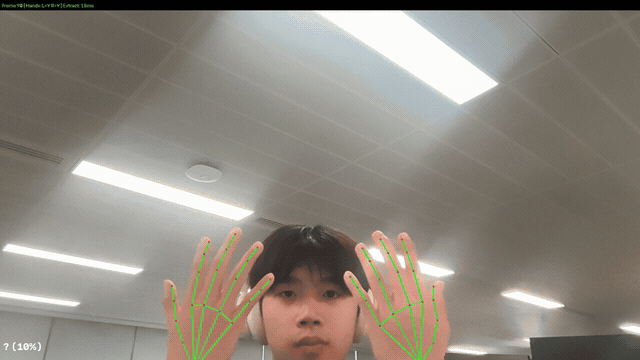

# Sign Language Interpreter



Real-time British Sign Language (BSL) to English interpreter that runs entirely offline. It tracks hand landmarks with MediaPipe, classifies signs, and translates BSL grammar to natural English using a small language model (SLM).

> **Work in progress.** Currently at hand detection and landmark extraction — the pipeline tracks 21-point hand skeletons at ~30 FPS with One Euro filtering. Sign classification and grammar translation are stubbed out pending BSL training data (BSL-1K / BOBSL, applied for academic access).

## Getting Started

Requires Python 3.11+ and a webcam (or a video file). MediaPipe runs on the CPU, so no GPU is needed yet.

```bash
git clone https://github.com/ephemerallyCaden/SignLangInterpreter.git
cd SignLangInterpreter
python3 -m venv .venv && source .venv/bin/activate
pip install -e ".[dev]"
```

Download the three MediaPipe models into `models/mediapipe/`. The folder is gitignored, and the app won't start without them:

```bash
mkdir -p models/mediapipe
base=https://storage.googleapis.com/mediapipe-models
curl -L -o models/mediapipe/hand_landmarker.task      $base/hand_landmarker/hand_landmarker/float16/latest/hand_landmarker.task
curl -L -o models/mediapipe/pose_landmarker_lite.task $base/pose_landmarker/pose_landmarker_lite/float16/latest/pose_landmarker_lite.task
curl -L -o models/mediapipe/face_landmarker.task      $base/face_landmarker/face_landmarker/float16/latest/face_landmarker.task
```

Run it from the repository root, since the default config path is relative:

```bash
python -m src.main
```

A window titled "BSL Interpreter" opens on camera 0 and draws a skeleton over each detected hand. Recognised output appears in the corner of the window and in the terminal. Press `q` to quit.

## Usage

```bash
python -m src.main --video path/to/video.mp4    # read frames from a file instead of the camera
python -m src.main --record                     # save a diagnostics session to sessions/
python -m src.main --config configs/phase1.yaml # use another config file
```

`--record` writes a timestamped folder under `sessions/` with `summary.json` (session totals), `metrics.jsonl` (one line per frame), `events.log` (state changes), and `frames/` (annotated JPEG snapshots, every 30th frame by default).

## Features

What runs today:
- Hand, pose, and face landmarks from three MediaPipe landmarkers in VIDEO mode, which tracks hands between frames instead of re-detecting them every frame
- Landmarks normalised to signing space, scaled by a smoothed shoulder width from the pose model
- One Euro filtering on the raw hand landmarks to cut jitter
- A 5-frame grace period (about 167 ms at 30 FPS) before a hand counts as lost, so fast signing doesn't flicker
- Sliding windows of 1000 ms with a 500 ms stride, passed to the sign classifier
- Word-for-word English output from the classified glosses, shown in the overlay and the terminal

Stubbed until BSL training data arrives:
- Sign classification: a placeholder that returns `HELLO` when both hands are up and `UNKNOWN` (shown as `?`) for one hand. The planned version uses KNN/DTW on BSL-1K templates.
- Grammar translation: word-for-word gloss mapping with no reordering. The planned version runs a 4-bit SLM through llama.cpp.
- Non-manual signals: the rules can mark questions and negation, but no classifier feeds them yet, so they never fire. Face landmarks are extracted for that future classifier.

## Models

| File | MediaPipe task | Used for |
|------|----------------|----------|
| `hand_landmarker.task` | Hand Landmarker | 21 landmarks per hand, up to 2 hands |
| `pose_landmarker_lite.task` | Pose Landmarker (lite) | Shoulder width for scale normalisation |
| `face_landmarker.task` | Face Landmarker | 478 face landmarks, kept for the planned non-manual signal classifier |

## Configuration

Settings come from `configs/phase1.yaml`, validated by pydantic in `src/infrastructure/config.py`.

| Key | Default (from `configs/phase1.yaml`) |
|-----|---------|
| `camera.index` | `0` |
| `pipeline.window_size_ms` | `1000` |
| `pipeline.stride_ms` | `500` |
| `pipeline.max_queue_size` | `3` |
| `show_overlay` | `true` |
| `diagnostics.enabled` | `false` (code default; turn on with `--record`) |
| `diagnostics.output_dir` | `sessions` (code default) |
| `diagnostics.snapshot_interval` | `30` (code default) |

## Architecture

The code follows a ports-and-adapters layout: interfaces in `src/ports/`, implementations in `src/adapters/` (OpenCV camera, video file, MediaPipe, the stub classifier and rules, console and overlay output), and the windowing pipeline in `src/core/orchestrator.py`. [PROJECT_PLAN.md](PROJECT_PLAN.md) covers the full design: data model, phased roadmap, training data, and latency budgets.

## Development

```bash
make test   # pytest, 64 tests
make lint   # black, isort, flake8 and mypy
```

## License

This repository has no license file, so default copyright applies: ask the author before reusing the code.
